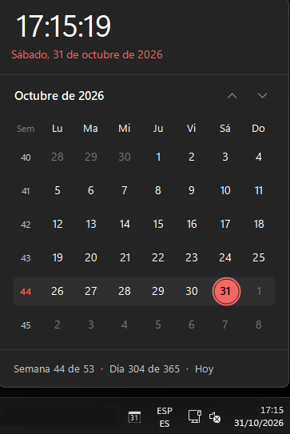

# GV Windows Calendar Pro

Calendario para la bandeja del sistema de Windows 10/11, clon del calendario de la barra de tareas, **con números de semana**.



## Cómo se usa

1. Instala la aplicación y ábrela desde el menú Inicio. El calendario se abre junto a la barra de tareas y el icono queda en la bandeja del sistema, al lado del reloj.
2. **¿No ves el icono?** Windows suele ocultar los iconos nuevos. Pulsa la **flechita (^)** de la bandeja del sistema, junto al reloj, y lo verás en el panel que se despliega.
3. Para tenerlo siempre visible, arrastra el icono desde ese panel hasta la barra de tareas.
4. Haz clic izquierdo en el icono para abrir o cerrar el calendario.
5. Haz clic derecho en el icono para cambiar las opciones o salir de la aplicación.

Si la aplicación ya está en marcha y no encuentras el icono, vuelve a abrirla desde el menú Inicio: se mostrará el calendario.

## Funciones

- Icono en la bandeja con el día del mes (o el número de semana, a elegir) y la semana actual en la información emergente.
- Clic izquierdo: abre/cierra el calendario junto a la barra de tareas (respeta tema claro/oscuro y color de énfasis).
- Columna de números de semana, con la semana actual resaltada. Clic en un número de semana para ver su rango de fechas.
- Vistas de mes, año y década (clic en el título). Rueda del ratón, flechas o RePág/AvPág para navegar; Inicio vuelve a hoy.
- Pie con semana del año, día del año y distancia relativa a hoy.
- Clic derecho: iniciar con Windows, numeración ISO 8601 (lunes) o EE. UU. (domingo), contenido del icono, mostrar segundos.

## Instalación

Ejecutar `dist/GVWindowsCalendarPro-Setup-<versión>.exe`. Por defecto se instala para el usuario actual (sin permisos de administrador) y
ofrece la opción **Iniciar automáticamente con Windows**, que también se puede cambiar después desde el menú del icono.
Requiere .NET Framework 4.8 (incluido en Windows 10 1903+ y Windows 11).

## Compilar

```bash
./build.sh   # dotnet build + Inno Setup (vía Wine en Linux)
```

- Proyecto: `src/GVCalendar` (C#, WinForms, .NET Framework 4.8).
- Instalador: `installer/GVWindowsCalendarPro.iss` (Inno Setup).
- Icono: `assets/make_icon.py` lo genera.
